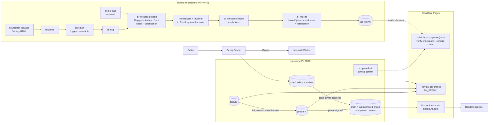
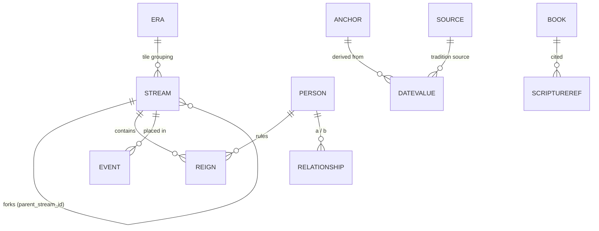
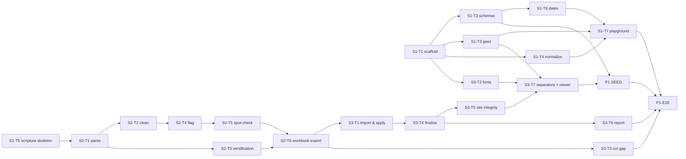
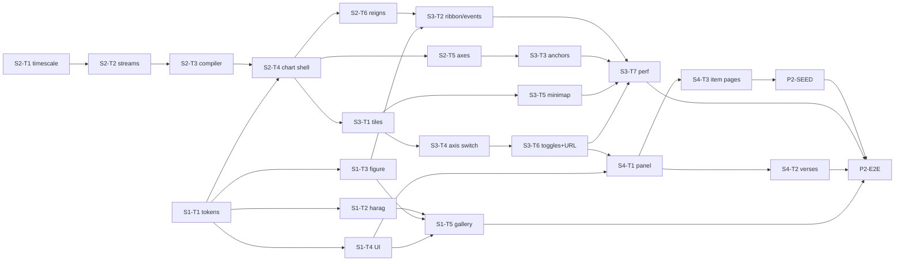
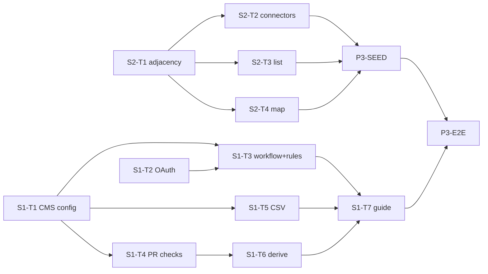
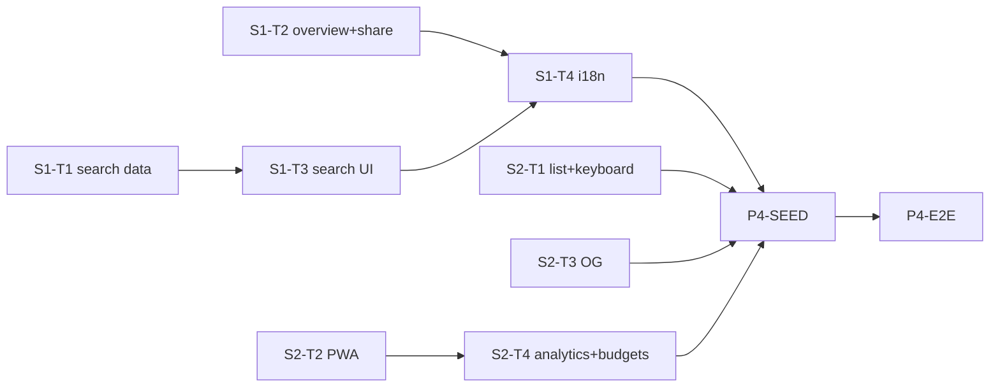
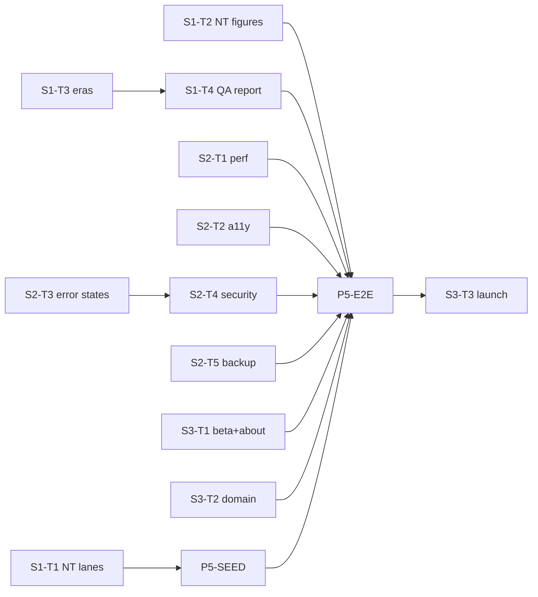

# Bible Karta: Software Architecture & Build Roadmap

| | |
|---|---|
| **Source PRD** | [`docs/prd-bible-chronology-chart_final.md`](docs/prd-bible-chronology-chart_final.md) (**v5.4**: the base text is the Society's HTML Bible) |
| **Stack** | Astro (static) + React chart island, on Cloudflare Pages |
| **Repos** | **`biblekarta` (public):** code + content. **`biblekarta-scripture` (private):** Bible text + text tools. |
| **Builder / reviewer** | solo, with Claude Code; you review your own phases |
| **Version** | v3, 2026-10-23. Changes from v2 are listed in §0. |

---

## 0. What changed in v3

| Change | Driver | Effect |
|---|---|---|
| The scripture source is **the Society's HTML Bible** (`am_new.zip`, 31,102 verses), with the **scan as the authority** | PRD v5.4 | The OCR pipeline is gone. Phase 1 becomes: parse → auto-clean → flag → **Excel workbook** → apply fixes → freeze. OCR is now only an optional helper for missing passages (e.g. Gen 31:33–55). |
| **Stored text keeps the HTML's words, separated by single spaces.** ፡ is generated at display time by one rule. | PRD v5.4; owner, Oct 2026 | This is a new pure function, `wordSeparators()`. The `CLAUDE.md` invariant changes from "keep ፡ as stored" to "never store ፡". Runs of whitespace in the HTML (e.g. Job's poetic line breaks) become one space through a logged, reversible cleaning rule; words never change. |
| A **versification map** (HTML ref → scan ref) is added | PRD v5.4 | The HTML uses KJV numbering; every reference in the app uses the scan's numbering. |
| Verses get a **`footnote`** field | PRD v5.4 | Edition footnotes are moved out of the verse text. Whether they are displayed is an open question (R6). |
| **Verse ranges:** a verse may carry **`to`** (e.g. `{"n":14,"to":15,"t":"…"}`) | Owner, Oct 2026 | This edition prints some verses together as one range (279 verses, mostly NT, where the HTML has only "-"). Proofreaders confirm each with the **Join** decision; the range is stored once and shown as "፲፬–፲፭". A reference to any verse in the range (e.g. Heb 2:15) opens the range. |
| **"!" is allowed punctuation** | Owner, Oct 2026 | The exclamation mark (ወዮ!, 261 uses) is stored like ። ፣ ፤ ፥ ?, and `wordSeparators()` never puts ፡ next to it. |
| **Targeted proofreading:** the flagged verses (436 in round 1, plus 279 joined and 12 with unexpected characters added in Oct 2026), 31 anchor/interval checks, and a 2–5% spot-check with a 0.5% escalation rule. A second person reviews every change. | PRD v5.4 | This replaces checking all 31k verses. The estimate drops from 8–14 weeks to 3–5. |
| **Public code repo + private scripture repo** | Your choice | Free branch protection and CODEOWNERS give **real FR-29 enforcement at merge time**. Actions minutes are unlimited. The promotion gate and the `production` branch are removed. |
| Derived dates must follow **this edition's numbers** (Septuagint-type before Abraham, Hebrew-type from the Exodus) | PRD v5.4 appendix | Adds a derived-date calculator in Phase 3. |

---

## 1. Overview

Bible Karta (የመጽሐፍ ቅዱስ ካርታ) is a free, non-profit web app. It shows the whole 66-book Bible as one Adams-style chart of flowing streams, drawn in the visual language of an Ethiopian brana manuscript. Readers are Amharic speakers, mostly on phones with variable bandwidth. They can:
- scroll and zoom through history
- tap a king or prophet
- read the exact verses from the Bible Society of Ethiopia's text

Each item shows two dates: the Ethiopian traditional date and the scholarly date.

**What the architecture must get right**
1. **The chart.** It must be fast and beautiful on cheap Android phones: 60 fps pan/zoom, crisp Ethiopic text, LCP ≤ 3 s on 3G.
2. **Exact scripture.**
   - The HTML text is cleaned by logged, reversible rules.
   - Flagged and sampled verses are corrected against the scan by one person and reviewed by a second.
   - The text is then frozen with checksums. Nothing changes a character after that.
   - It's displayed in the scan's book order, names and verse numbering, with ፡ between words as printed.
3. **Honest dates.** Every date carries its method and source. Correcting an anchor flags every date derived from it.
4. **Zero recurring hosting cost.**
5. **Every phase is something you can open and test,** with a preview URL, a demo script, E2E tests and a tag.

**A note on the PRD.** Its user stories have no acceptance criteria. FR-1…30 and DR-1…13 are precise enough to stand in, so the demo scripts and E2E tests cite them.

## 2. Chosen Stack & Rationale

| Layer | Choice | Why it fits Bible Karta |
|---|---|---|
| Site | **Astro 7, static output** | A static page per person, event and era, so shared links and SEO work. The list view (DR-13) is plain HTML. Pages ship almost no JS apart from the chart island. |
| Chart | **React 19 island + SVG + d3-zoom** | Crisp, selectable Ethiopic text. A Canvas fallback is kept for the stream layer only (PRD risk #9). |
| Languages | **TypeScript strict** for the site; **Python 3.12 + uv** for the text tools | Python has the best HTML-parsing and Excel (openpyxl) tooling. |
| Content | **JSON, one file per entry, validated by Zod** | Fits Decap. One schema definition is used everywhere. |
| CMS | **Decap CMS**, editorial workflow | Has draft → review → publish today (Sveltia has deferred it to 2.0). |
| CMS login | **Sveltia CMS Auth** worker on **Cloudflare Workers (free)** | GitHub OAuth without Netlify. The scope is `public_repo`. |
| Hosting & previews | **Cloudflare Pages Git integration (free)** on the public repo | Native preview URL per branch (`<branch>.biblekarta.pages.dev`). The production branch is `main`. The build fetches the private scripture at a pinned commit (§8). |
| Repo rules | **GitHub rulesets + CODEOWNERS** (free on public repos) | Required checks on `phase-*` and `main`. Code-owner approval is required for `content/`, `scripture.lock` and security files (FR-29). |
| CI | **GitHub Actions** (unlimited minutes on public repos) | Lint, type check, tests, validation, scripture checksums, E2E, and the automated Claude PR review. |
| Search | **FlexSearch** in a Web Worker, plus an Amharic normalizer | |
| Offline | **@vite-pwa/astro** (Workbox) | |
| Share images | **satori + @resvg/resvg-js** at build time | |
| Tests | **Vitest**, **pytest**, **Playwright** | |
| Scripture tools | **Python:** `selectolax` (HTML), `openpyxl` (workbook), `typer` (CLI) | Parses 1,189 chapter files in seconds. The workbook is the proofreaders' tool, which suits a non-technical second reviewer. |
| Gap OCR (optional) | **Google Cloud Vision** `DOCUMENT_TEXT_DETECTION` (first 1,000 pages/month free) or Document AI ($1.50 per 1,000 pages) | Only for passages missing from the HTML. That's a few dozen pages, so it's effectively $0. Typing the passage by hand is equally valid. |

## 3. System Architecture

| Component | Where | Responsibility |
|---|---|---|
| `bk` CLI | `biblekarta-scripture/tools/bk` | parse, clean, flag, workbook export/import, sample, versify, ocr-gap, finalize, verify, report |
| Workbook rounds | `biblekarta-scripture/rounds/round-N.xlsx` | Exported for proofreading, filled in, then imported. The decisions are logged to `decisions/round-N.jsonl`. |
| Frozen text | `biblekarta-scripture/scripture/` | `books/*.json`, `checksums.json`, `verse-counts.json`, `versification.json`, `books-meta.json`, `provenance/` |
| `scripture.lock` | public repo | The scripture commit the site builds from. Updating it is a code-owner-approved PR. |
| Data compiler | Cloudflare build | Validates, filters canon, lays out streams on both axes, and writes tiles, the index, search data and OG images |
| Site + chart island | Cloudflare Pages / browser | Static pages; SVG rendering, LOD, panel, connectors |
| `cms-auth` worker | Cloudflare Workers | GitHub OAuth for Decap |

**Runtime design (unchanged)**
- **Layout at build time, drawing at runtime.** Stream paths, lane packing and reign boxes are computed for both axes in the build.
- **The browser** applies a horizontal-only zoom transform to one geometry `<g>`, and re-places labels in screen space on a throttled viewport, with LOD.
- **Four SVG layers:** grid → geometry → labels → overlay.
- **Time axes:** traditional = linear AA years. Scholarly = linear astronomical years, plus a tradition-only band for pre-Abraham items. `x(year, axis)` in `timescale.ts` is the only mapping.

**Verse display path**
1. Stored verse text (spaces, as in the HTML after correction).
2. → `wordSeparators(text)`: one ፡ between words, none next to ። ፣ ፤ ፥ ? !.
3. → rendered as a plain text node.

The rule is reviewer-approved against sample scan pages (R5). Checksums cover the stored text, and the rule has its own golden tests.

## 4. Data Model

**Content entities.** These are as in v2. Δ marks a change from the PRD.

| Entity | Fields |
|---|---|
| `Stream` | id, Δslug, name_am, name_en, Δkind (`polity`\|`ribbon`\|`lane`), fill_color, parent_stream_id, Δfork / end `YearPair`, Δwidth_keyframes[] {at: YearPair, width 1–5}, lane_order, canon |
| `Era` Δ | id, slug, names, start/end YearPair, certainty, status (live/coming_soon), order, gap?, lod?, minimap_weight? |
| `Person` | id, Δslug, names, aliases[], figure_kind, Δfigure_tone?, Δimportance 1–5, stream_id, birth/death DateValue ×2, Δnote_am/en, refs[], canon |
| `Reign` | id, person_id, stream_id, start/end DateValue ×2, coregency_flag |
| `Event` | as in the PRD, plus Δslug and Δnote_am/en |
| `Relationship` | person_a_id, person_b_id, type, label_am, date?, refs[], canon |
| `DateValue` | start, end, certainty, method, source_id, anchor_id, derivation_refs[], **Δanchor_value_used**, relative_text_am |
| `Anchor` | id, labels, date {start, end?}, external_source, confidence, notes |
| `ScriptureRef` | book_id, chapter, verse_start, verse_end. **Always in the scan's numbering.** |
| `Book` | id, name_am (**scan name**), name_en, Δabbr_am, testament, canon, order_66 (**scan order**), order_81, period_setting. It lives in `scripture/books-meta.json` and is read by the site. |
| `Source` | id, citation, kind |

**Scripture data (private repo).** These are new or changed in v3.

| File | Shape / rule |
|---|---|
| `scripture/books/<id>.json` | `{"book","edition":"BSE-1954-html+scan","status":"verified","chapters":[{"n","verses":[{"n","to?","t","footnote?"}]}]}`. `n` is the **scan** number. `to` (optional) is the last verse of a range printed as one (n–to); the verses inside a range have no entry of their own. `t` holds the words separated by single spaces, as corrected; **it never contains ፡**. |
| `scripture/checksums.json` | SHA-256 of each verse's `t`, keyed `gen.1.1` (a range by its first verse) |
| `scripture/verse-counts.json` | Per-chapter counts **in the scan's numbering**; every number in a range counts |
| `scripture/versification.json` | `[{html: "job.40.24", scan: ["job.40.24", …, "job.40.32"], kind: "split"\|"merge"\|"renumber", note}]`. Used by import/finalize, and to translate any HTML-numbered reference. |
| `scripture/books-meta.json` | id, scan `name_am`, HTML `name_am` (e.g. ሚልክያ), name_en, testament, scan `order_66`, HTML order, `abbr_am` (once approved) |
| `cleaning-log.jsonl` | One line per automatic change: `{ref, rule, before, after}`. Replaying the log in reverse restores the raw HTML text. |
| `decisions/round-N.jsonl` | One line per workbook row applied: `{ref_html, ref_scan, decision, final_text, proofreader, reviewer, status, round}` |
| `provenance/<id>.json` | rounds, reviewers, the flags resolved, the spot-check size and error rate, escalations, date |

**Text rules (validation, enforced in `bk finalize`, `bk verify` and the site build)**
- Allowed characters: Ethiopic fidel, and the punctuation ። ፣ ፤ ፥ ? ! plus single spaces. **No ፡ in stored text.**
- No Latin letters.
- Digits only in the reviewed allowlist (e.g. `1sa.13.21`).
- No leading or trailing whitespace, no double spaces, NFC (fail rather than silently change).
- Verse counts equal `verse-counts.json` (scan numbering).
- No empty verses.
- **Fidel normalization is never applied to stored text.**
- **Only books with `status: "verified"` are published.** Others show "በዝግጅት ላይ".

## 5. API Design (static data contracts)

| Path | Contents | Budget |
|---|---|---|
| `/data/index.json` | eras, stream meta, anchors, timescale config, minimap, build id, scripture version | ≤ 30 KB gz |
| `/data/tiles/<era>.json` | stream paths (both axes), reigns, people, events, relationships + adjacency + stubs | ≤ 100 KB gz each |
| `/data/scripture/<book>.json` | one verified book, byte-copied from the pinned scripture commit | lazy |
| `/data/search.json` | compact rows for the search worker | ≤ 150 KB gz |
| `/og/<kind>/<slug>.png` | share images | |

**URLs (FR-10)**

| URL | What it is |
|---|---|
| `/?y=&z=&ax=s\|t&sel=p:<slug>&hide=` | chart view state |
| `/p/<slug>/`, `/e/<slug>/`, `/era/<slug>/` | item pages (no verse text in the HTML) |
| `/list/`, `/eras/` | list view, era overview |
| `/en/…` | English UI (scripture stays Amharic) |
| `/admin/` | CMS |
| `/dev/*` | preview-only tools (playground, scripture viewer, separator samples). **Never in production.** |

**`cms-auth` worker:** `GET /auth` → GitHub → `GET /callback` → token posted to an allowed origin only.

## 6. Auth & Security

- **Readers:** no accounts, no cookies; a static, read-only site.
- **Editors:** GitHub login through Decap; they are collaborators with write access to `biblekarta`. Scripture is not a CMS collection, and editors have **no access** to the scripture repo.
- **Two-person review (FR-29), enforced at merge time:**
  - **Rulesets on `main`:** `main-checks` (pull request required; required checks `web` and `tools`; no force push; **no bypass**) and `main-review` (**code-owner review required**; the admin role may bypass it only through a pull request). The owner is also the content reviewer, so editors' content PRs get two people, but the owner's own edits to code-owned paths get one; add a second code owner when one exists (`docs/repo-rules.md`).
  - **`CODEOWNERS`:** `/content/` → the reviewer(s) + owner. `/scripture.lock`, `/.github/`, `/workers/`, `/public/admin/`, `/src/build/verify-scripture.ts` → owner.
  - A code-owner review must come from someone other than the PR author, so every content change needs a second person. Your own code PRs (phase → `main`) touch no code-owned content and merge after CI.
  - **Ruleset on `phase-*`:** pull request required; required checks `web` and `tools`. There is no automatic Claude review: the owner orders a review of each PR in a Claude Code session, then merges.
- **Public-repo hygiene:**
  - No secrets in the repo.
  - Secrets are not exposed to fork PRs. Workflows use `pull_request`, never `pull_request_target`.
  - Third-party actions are pinned by SHA (Phase 5).
  - Secret scanning and Dependabot are on.
- **What becomes public:** code, content JSON, editors' draft PRs (CMS branches) and their GitHub names, and issues. Beta-tester feedback goes through a form, not public issues.
- **Scripture access:**
  - **Cloudflare build:** the env secret `SCRIPTURE_TOKEN` is a fine-grained PAT with Contents: read on `biblekarta-scripture` only. The build clones the commit in `scripture.lock`.
  - **CI:** the same secret is used on `push` and same-repo PRs. Fork PRs fall back to `scripture-fixtures/`, a clearly labeled test book with non-scriptural sample sentences, never invented verses.
- **Scripture integrity:** checksums are verified in the scripture repo's CI, in the site CI and in the Cloudflare build. Books are copied byte-for-byte. The verse renderer has an equality test (stored text + rule → DOM). Only `bk finalize` writes `scripture/books/`.
- **Headers:** a strict CSP for the site and a separate minimal one for `/admin/`, plus HSTS, `nosniff` and `Referrer-Policy`.
- **Verse text is public once served.** This is inherent to showing verses. Confirm the Society's agreement covers it (R2).

## 7. Third-Party Integrations

| Service | Use | Cost |
|---|---|---|
| Cloudflare Pages | hosting, per-branch previews | free (500 builds/month) |
| Cloudflare Workers | CMS OAuth | free |
| GitHub | public repo (rulesets, CODEOWNERS, unlimited Actions) + private repo | free |
| claude-code-action | automated PR review | Anthropic API usage or subscription (a dev cost) |
| Google Cloud Vision / Document AI | **optional** OCR for missing passages | ~$0 (Vision: 1,000 free pages/month) |
| Cloudflare Web Analytics | page views, Web Vitals | free |
| Event analytics | verse-open rate, search success | **open:** GoatCounter or Workers Analytics Engine |
| Fonts | Abyssinica SIL, Noto Sans Ethiopic (OFL), self-hosted | free |

## 8. Infra & Deployment

**Branching (public repo)**

| Branch | Rule |
|---|---|
| `main` | Always the last approved phase, plus code-owner-approved content PRs. **Production deploys from `main`.** |
| `phase-<N>` | Created from `main` at phase start. Merge `main` in whenever content lands. |
| `task/<TASK-ID>` | Created from `phase-<N>`; its PR goes into `phase-<N>` and is merged by the owner after the checks pass and a Claude review the owner orders. |
| `cms/<collection>/<slug>` | Decap editor branches; PRs into `main`, which need a code owner's approval. |

When a phase is approved, merge `phase-<N>` → `main` and tag `v0.<N>-phase<N>`.

**Phase 1 exception.** Phase 1's task PRs were merged straight into `main` (there was no `phase-1` branch), so its preview and e2e ran on `main` PRs instead. From Phase 2 on, the owner creates `phase-<N>` at phase start and task PRs target it.

**Scripture repo (private).** Tasks tagged `repo: scripture` run there. The flow is `task/<ID>` → PR → `main`. After CI passes and the owner has ordered a Claude review, `scripts/merge-when-green.sh` (or the owner) merges. Frozen releases are tagged `text-v<N>`. The site picks up a release through a `scripture.lock` PR.

**Preview deployments (Cloudflare Pages Git integration, public repo)**
- **Production branch:** `main`.
- **Preview branches:** `phase-*`, `task/*` and `cms/*`. Cloudflare comments the URL on each PR.
- **Build command:** `scripts/fetch-scripture.sh && pnpm build`. The fetch step uses `SCRIPTURE_TOKEN`, checks out `scripture.lock`, and verifies the checksums. If the token is missing, it falls back to the fixtures and sets `BK_SCRIPTURE=fixtures`.
- **Watch paths:** exclude `docs/**` and `design-reference/**`.
- **Environment variables:** Preview sets `BK_SEED=1`, `PUBLIC_BETA=true` and `SCRIPTURE_TOKEN`. Production sets `SCRIPTURE_TOKEN` only.

**Seed data**
- `seed/` holds the Board 5 Divided Kingdom data, growing each phase through the `P<N>-SEED` tasks.
- It's overlaid on previews (`BK_SEED=1`) and never in production.
- **It never contains invented verse text, dates or names.**
- Proofreading tests use a small real-HTML fixture in the private repo's `tests/fixtures/`, plus your round-1 workbook (`flagged-verses-v1.xlsx`) as the test oracle.

**CI**
- **Public repo:**
  - `ci.yml` (PRs and `main`): lint, type check, unit tests, `validate`, `verify:scripture`, build. It runs twice: seeded, and production, which proves `/dev` is excluded.
  - `e2e.yml`: Playwright on PRs into, and pushes to, `main` and `phase-*`.
- **Scripture repo:** `ci.yml` runs ruff, pytest and `bk verify`.
- **No automatic Claude review in either repo.** There's no `CLAUDE_CODE_OAUTH_TOKEN`; the owner orders a review in a Claude Code session ("review PR #<n> against docs/tasks/<ID>.md and CLAUDE.md") before merging.

## 9. Non-Functional Requirements

| Concern | Plan |
|---|---|
| Performance | Initial JS ≤ 250 KB gz (chart island ≤ 180 KB). Fonts subset to WOFF2. Tiles within ±1 era are loaded. Transform-only gestures plus LOD. Perf spec at 4× CPU throttle (p95 frame ≤ 20 ms). |
| Scale | A static CDN copes easily with 10k monthly users. The compiler warns at 80% of the tile budget. |
| Offline | The app shell and fonts are precached. Tiles and books use stale-while-revalidate keyed by build id and scripture version. |
| Accessibility | Contrast unit tests, `/list/`, focusable overlay items, `aria-hidden` figures. |
| Observability | Cloudflare Web Analytics plus event counts. Build summary in CI. `bk report` gives scripture verification progress. |
| Hosting cost | $0/month plus the domain. Gap OCR ≈ $0. |
| CI/build budgets | Actions minutes are unlimited on the public repo. The private repo's CI is small (pytest only). Cloudflare: about 100–250 builds/month, under the 500 limit. |
| Maintainability | Pure, tested modules. `CLAUDE.md` in each repo carries the invariants. |

## 10. Risks & Open Questions

| # | Item | Handling |
|---|---|---|
| R1 | **The quality of the ~30,600 unflagged verses** is unknown until the spot-check | 2–5% random sample, stratified by book. Above 0.5% errors in a book, that book is widened (auto-added to the next round). `bk report` tracks it (PRD risk #13). |
| R2 | **Verse JSON is downloadable from the live site** | Confirm with the Society's agreement. Per-book files, no bulk endpoint. |
| R3 | **Versification map completeness.** The HTML uses KJV numbering; the scan may differ in more places than the 3 merged-verse cases found so far. | Auto-candidates from merged-verse markers and count mismatches. A "Versification" workbook sheet confirms each affected chapter's scan count. `bk finalize` refuses chapters whose count is unconfirmed. |
| R4 | **Missing passages** (293 empty verses, e.g. Gen 31:33–55) | Transcribed from the scan in the workbook (Decision = Transcribed). Optional `bk ocr-gap` pre-fills a draft; a second person reviews. |
| R5 | **The ፡ display rule** must match the scan | `/dev/scripture/separator-samples` shows the edge cases. The reviewer approves against sample scan pages. The rule lives in one function with golden tests. Until approval, previews label it "pending". |
| R6 | **Edition footnotes** are now stored separately. Should they be shown? | The default is stored but not displayed. If the reviewer and Society agree, Phase 2 shows them behind a "ማስታወሻ" toggle in the verse block. **Decide before Phase 2 Sprint 4.** |
| R7 | **Derivations must follow the edition's numbers** (Exod 12:40 = 430 years "in Egypt"; 1 Kgs 6:1 = 480 years) | A derived-date calculator (Phase 3) takes intervals only from references verified in the anchor sheet. |
| R8 | **Public repo exposure:** editors' unpublished drafts and names are visible | Accepted by you. The editor guide says so. Theology debates can happen in private channels before a CMS edit. |
| R9 | **Event analytics provider** | Decide in Phase 4. |
| R10 | **Pre-Abraham items on the scholarly axis** | Use the tradition-only band; the reviewer checks it. |
| R11 | **The traditional-axis label** (PRD risk #3) | One i18n string; the reviewer decides. |
| R12 | **Content entry volume** | CSV importer (Phase 3), QA report (Phase 5), launch with importance 4–5 items. |
| R13 | **You review your own phases** | The phase Opus review plus the demo script. Show the Phase 2 preview to the church reviewer, because the design and naming get locked in there. |

---

## 11. Roadmap

**Running tasks**
- Each task is a file, `docs/tasks/<ID>.md`, in the public repo. Its `repo` field says where it runs:
  - `site` = `biblekarta`
  - `scripture` = `biblekarta-scripture`, checked out next to it as `../biblekarta-scripture`
- Run one task with `scripts/run-task.sh <ID>`. It reads the model and repo from the task file.
- Interactively, switch models with `/model haiku`, `/model sonnet` or `/model opus` (`claude-haiku-5-5`, `claude-sonnet-5-5`, `claude-opus-5-5`), then run `/run-task <ID>` in the right repo.
- **Tasks in the same parallel group can run at the same time** in separate git worktrees: `scripts/parallel-group.sh <phase> <group>`. Tasks in a group never share files.

**Review tiers**
Every PR gets a Claude review that **the owner orders** in a Claude Code session; nothing reviews or merges automatically. The tier says which model to use:
- `auto`: a Sonnet review is enough.
- `opus`: review with Opus.
- Every phase ends with `/phase-review <N>`.

**Task files.** Phases 1 and 2 have full task files (Phase 2's were generated at the Phase 1 close-out, tag `v0.1-phase1`). Phases 3–5 are one-line entries; their task files are generated when the previous phase closes.

### Phase 1: Foundation & verified scripture pipeline (3 sprints, 22 tasks)

**Done when:**
- the site repo, CI, rulesets and previews work
- the whole HTML Bible is parsed, auto-cleaned and flagged
- round 1 of the workbook (flagged + anchor + spot-check + versification sheets) has been exported, filled and re-imported
- at least the books for the Phase 2 slice (1–2 Kings, plus anything else you finish) are verified and frozen as `text-v1`
- the site renders them with the ፡ rule on a preview
- `bk report` shows the remaining work

Whole-Bible verification continues in the background (3–5 weeks of human work) and must be complete before launch (Phase 5).

| ID | Title | Repo | Model | Review | Depends on | Group |
|---|---|---|---|---|---|---|
| P1-S1-T1 | Scaffold site repo, stub scripts, Cloudflare + rulesets + CODEOWNERS docs | site | haiku | auto | — | S1-A |
| P1-S1-T2 | Zod schemas + content validator | site | sonnet | auto | P1-S1-T1 | S1-B |
| P1-S1-T3 | Ge'ez numerals | site | sonnet | auto | P1-S1-T1 | S1-B |
| P1-S1-T4 | Amharic search normalizer | site | sonnet | auto | P1-S1-T1 | S1-B |
| P1-S1-T5 | Scripture repo skeleton: CLI loader, `books-meta.json` (scan + HTML names/order) | scripture | haiku | auto | — | S1-B |
| P1-S1-T6 | Date utilities | site | sonnet | auto | P1-S1-T2 | S1-C |
| P1-S1-T7 | Dev playground page | site | haiku | auto | P1-S1-T3, P1-S1-T4, P1-S1-T6 | S1-D |
| P1-S2-T1 | HTML parser (verse spans, hidden verse-1 marker) | scripture | sonnet | auto | P1-S1-T5 | S2-A |
| P1-S2-T2 | Auto-cleaner: logged, reversible rules + old-font suggestions | scripture | sonnet | opus | P1-S2-T1 | S2-B |
| P1-S2-T3 | Versification candidates + map format | scripture | opus | opus | P1-S2-T1 | S2-B |
| P1-S2-T4 | Issue flagger (reproduces the 436 flags) | scripture | sonnet | auto | P1-S2-T2 | S2-C |
| P1-S2-T5 | Spot-check sampler + escalation rule | scripture | sonnet | auto | P1-S2-T4 | S2-D |
| P1-S2-T6 | Workbook export (Flagged, Anchor, Spot check, Versification sheets) | scripture | sonnet | auto | P1-S2-T3, P1-S2-T5 | S2-E |
| P1-S3-T1 | Workbook import & apply (incl. verse splits, review enforcement) | scripture | sonnet | opus | P1-S2-T6 | S3-A |
| P1-S3-T2 | Fonts (self-hosted, subset) + base tokens | site | haiku | auto | P1-S1-T1 | S3-A |
| P1-S3-T3 | Optional gap OCR helper (`bk ocr-gap`) | scripture | sonnet | auto | P1-S2-T6 | S3-A |
| P1-S3-T4 | Finalize & freeze: validation, checksums, counts, provenance, `bk verify` | scripture | sonnet | opus | P1-S3-T1 | S3-B |
| P1-S3-T5 | Site scripture fetch + integrity (`scripture.lock`, fixtures, byte copy) | site | sonnet | opus | P1-S3-T4 | S3-C |
| P1-S3-T6 | Verification report (`bk report`) | scripture | haiku | auto | P1-S3-T4 | S3-C |
| P1-S3-T7 | `wordSeparators()` + verse renderer + `/dev/scripture` viewer + separator samples | site | sonnet | auto | P1-S3-T2, P1-S3-T5, P1-S1-T3 | S3-D |
| P1-SEED | Seed: Board 5 dataset | site | haiku | auto | P1-S1-T2, P1-S3-T7 | S3-E |
| P1-E2E | Phase 1 E2E (site Playwright + scripture pipeline golden test) | site + scripture | sonnet | auto | all P1 | S3-F |

Review mix: 5 of 22 are `opus` (23%). Every one of them writes or guards scripture text, or fixes the numbering of every reference. The one Opus *model* task is versification, which is the most ambiguous mapping.

### Phase 2: Chart slice, the Divided Kingdom (4 sprints, 23 tasks)

**Done when:** the Board 5 era is live on a preview, with streams, reigns, prophets, anchors, both axes, minimap, tap → panel with dual dates and provenance, verified verses with ፡, and item pages. It's unchanged from v2, except that the verse block reuses `wordSeparators()` and may show footnotes (R6).

| ID | Title | Model | Review | Depends on | Group |
|---|---|---|---|---|---|
| P2-S1-T1 | Design tokens, vellum, rubrication + contrast tests | sonnet | auto | P1-S3-T2 | S1-A |
| P2-S1-T2 | Harag band component | haiku | auto | P2-S1-T1 | S1-B |
| P2-S1-T3 | Figure component + symbol sprite | sonnet | auto | P2-S1-T1 | S1-B |
| P2-S1-T4 | UI primitives + Panel / bottom sheet | sonnet | auto | P2-S1-T1 | S1-B |
| P2-S1-T5 | Dev design gallery | haiku | auto | P2-S1-T2..T4 | S1-C |
| P2-S2-T1 | Dual-axis time scale with tradition-only band | opus | opus | P1-S1-T6 | S2-A |
| P2-S2-T2 | Stream layout (lanes, keyframes, forks, ends) | opus | opus | P2-S2-T1 | S2-B |
| P2-S2-T3 | Data compiler → index + tiles + seed overlay + budgets | sonnet | auto | P2-S2-T2, P1-SEED | S2-C |
| P2-S2-T4 | Chart shell: SVG layers, horizontal-only d3-zoom, layer stubs | opus | opus | P2-S2-T3, P2-S1-T1 | S2-D |
| P2-S2-T5 | Axes & decade grid (Ge'ez / Arabic) | sonnet | auto | P2-S2-T4 | S2-E |
| P2-S2-T6 | Reign segments, dividers, LOD labels, tooltips | sonnet | auto | P2-S2-T4 | S2-E |
| P2-S3-T1 | Tile loading & virtualization | sonnet | auto | P2-S2-T4 | S3-A |
| P2-S3-T2 | Prophet ribbon, events, Ethiopia lane, in-stream figures | sonnet | auto | P2-S2-T6, P2-S1-T3 | S3-A |
| P2-S3-T3 | Anchor lines, tradition-only band, gap labels | sonnet | auto | P2-S2-T5 | S3-A |
| P2-S3-T4 | Axis switch, focus-preserving | sonnet | auto | P2-S3-T1 | S3-B |
| P2-S3-T5 | Minimap | sonnet | auto | P2-S3-T1 | S3-B |
| P2-S3-T6 | Lane toggles + URL view-state sync | sonnet | auto | P2-S3-T4 | S3-C |
| P2-S3-T7 | Performance pass (throttled CPU, stress seed) | opus | opus | P2-S3-T2..T6 | S3-D |
| P2-S4-T1 | Detail panel: dual dates, certainty, provenance | sonnet | auto | P2-S3-T6, P2-S1-T4 | S4-A |
| P2-S4-T2 | Verse block (reuses VerseText + ፡ rule) + refs + footnote toggle (if R6 approved) + editor note + credit | sonnet | auto | P2-S4-T1, P1-S3-T7 | S4-B |
| P2-S4-T3 | Static person/event/era pages + share meta | sonnet | auto | P2-S4-T1 | S4-B |
| P2-SEED | Seed: fill every Phase 2 demo step | haiku | auto | P2-S4-T3 | S4-C |
| P2-E2E | Phase 2 E2E tests | sonnet | auto | all P2 | S4-D |

Review mix: 4 of 23 are `opus` (17%).

### Phase 3: Editors, relationships & derived dates (2 sprints, 13 tasks)

**Done when:** an editor can log in, add a king with a reign and a marriage, a second person approves the PR (enforced by GitHub), and it goes live. The content lead can compute a derived date from verified intervals. Selecting a person shows their relationships on the chart, in the panel and on a map.

| ID | Title | Model | Review | Depends on | Group |
|---|---|---|---|---|---|
| P3-S1-T1 | Decap CMS config for all collections + drift test | sonnet | auto | — | S1-A |
| P3-S1-T2 | OAuth worker (Sveltia CMS Auth) on Workers | opus | opus | — | S1-A |
| P3-S1-T3 | Editorial workflow + rulesets/CODEOWNERS + CMS previews | sonnet | opus | P3-S1-T1, P3-S1-T2 | S1-B |
| P3-S1-T4 | PR validation comment + verse-range + stale-anchor checks | sonnet | auto | P3-S1-T1 | S1-B |
| P3-S1-T5 | CSV bulk importer | sonnet | auto | P3-S1-T1 | S1-B |
| P3-S1-T6 | Derived-date calculator (edition numbers, verified intervals only) | sonnet | opus | P3-S1-T4 | S1-C |
| P3-S1-T7 | Editor guide (Amharic + English) | haiku | auto | P3-S1-T3..T6 | S1-D |
| P3-S2-T1 | Relationship adjacency + stubs in tiles | haiku | auto | — | S2-A |
| P3-S2-T2 | On-chart connectors (DR-8) + off-screen chips | sonnet | auto | P3-S2-T1 | S2-B |
| P3-S2-T3 | Panel relationship list | haiku | auto | P3-S2-T1 | S2-B |
| P3-S2-T4 | Relationship map view (deterministic layout) | opus | opus | P3-S2-T1 | S2-B |
| P3-SEED | Seed: relationship-rich data + editor demo flow | haiku | auto | P3-S2-T2..T4 | S2-C |
| P3-E2E | Phase 3 E2E tests | sonnet | auto | all P3 | S2-D |

Review mix: 4 of 13 are `opus` (31%): auth, merge rules, a layout algorithm, and date derivation. That's just under the one-third limit, and it's justified because all four are security- or correctness-critical.

### Phase 4: Search, language & offline (2 sprints, 10 tasks). Unchanged from v2.

| ID | Title | Model | Review | Depends on | Group |
|---|---|---|---|---|---|
| P4-S1-T1 | Search data + FlexSearch worker | sonnet | auto | — | S1-A |
| P4-S1-T2 | Era overview + share button | haiku | auto | — | S1-A |
| P4-S1-T3 | Search UI (combobox, IME-safe) + jump-to-result | sonnet | auto | P4-S1-T1 | S1-B |
| P4-S1-T4 | i18n: Amharic/English UI + `/en/` routes | sonnet | auto | P4-S1-T2, P4-S1-T3 | S1-C |
| P4-S2-T1 | Accessible list view + chart keyboard navigation | sonnet | auto | — | S2-A |
| P4-S2-T2 | PWA offline caching | sonnet | auto | — | S2-A |
| P4-S2-T3 | OG share images | sonnet | auto | — | S2-A |
| P4-S2-T4 | Analytics + performance budgets in CI | haiku | auto | P4-S2-T2 | S2-B |
| P4-SEED | Seed: search-friendly names, aliases, English names | haiku | auto | P4-S2-T1..T4 | S2-C |
| P4-E2E | Phase 4 E2E tests | sonnet | auto | all P4 | S2-D |

Review mix: 0 of 10 are `opus`. These are routine features; the phase review covers the cross-cutting i18n change.

### Phase 5: New Testament, hardening & launch (3 sprints, 14 tasks)

**Done when:** creation → AD 100 is navigable, **every book is verified and frozen**, the NT figures are approval-gated, the audits pass, beta testers have used it, and biblekarta.com is live.

| ID | Title | Model | Review | Depends on | Group |
|---|---|---|---|---|---|
| P5-S1-T1 | NT lanes, anchors, BC/AD crossing | sonnet | auto | — | S1-A |
| P5-S1-T2 | NT icon figures behind a reviewer-approval gate | sonnet | auto | — | S1-A |
| P5-S1-T3 | Whole-Bible era list + "coming soon" states | haiku | auto | — | S1-A |
| P5-S1-T4 | Editor content-QA report (incl. scripture verification status per book) | sonnet | auto | P5-S1-T3 | S1-B |
| P5-S2-T1 | Dense-data performance + Canvas-fallback decision | opus | opus | — | S2-A |
| P5-S2-T2 | Accessibility audit & fixes | sonnet | auto | — | S2-A |
| P5-S2-T3 | Error, offline and 404 states | haiku | auto | — | S2-A |
| P5-S2-T4 | Security review: headers, public-repo hygiene, CI, secrets | opus | opus | P5-S2-T3 | S2-B |
| P5-S2-T5 | Backup & recovery (both repos + workbook rounds) | haiku | auto | — | S2-B |
| P5-S3-T1 | Beta banner, feedback form link, about & methodology pages | haiku | auto | — | S3-A |
| P5-S3-T2 | Domain, DNS, sitemap, robots | haiku | auto | — | S3-A |
| P5-SEED | Seed: NT demo data | haiku | auto | P5-S1-T1 | S3-B |
| P5-E2E | Phase 5 E2E tests | sonnet | auto | all P5 except T3 | S3-C |
| P5-S3-T3 | Launch checklist (incl. all 66 books `verified`) | sonnet | opus | P5-E2E | S3-D |

Review mix: 3 of 14 are `opus` (21%).

### Phase 6 (future): PRD Phase 2
These are in `docs/backlog.md`: the 81-canon books and the 66/81 switch, journey maps, and poster export.

**Design reference.** `design-reference/board5-desktop.html` (approved) and `design-reference/figure.html`.
